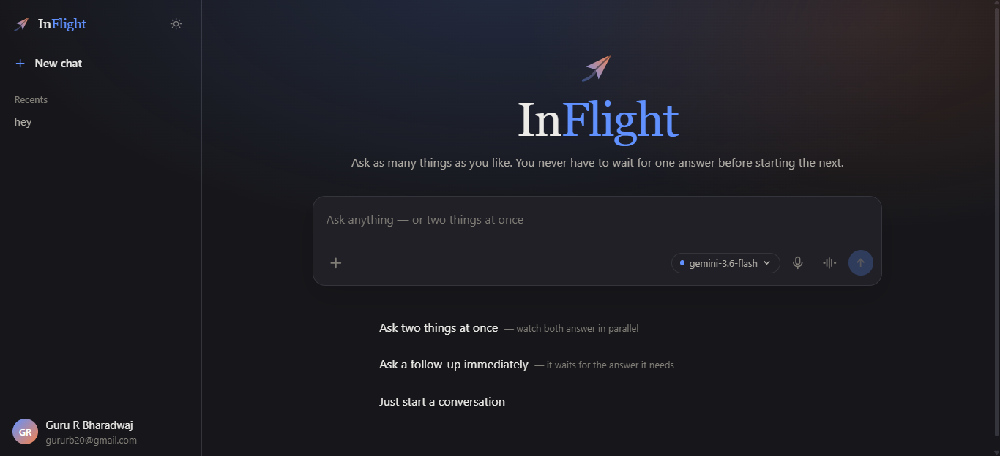
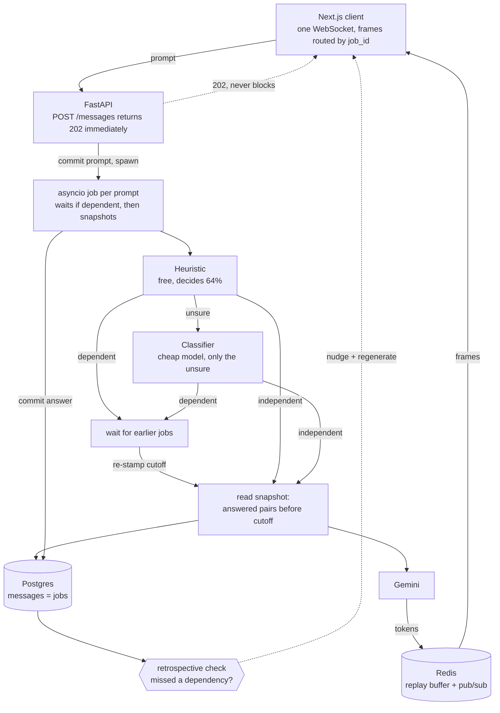

# InFlight

**A chat where the input box is never locked — N answers generate at once against one shared history, reconciled by snapshot isolation instead of a queue.**

[](.github/workflows/ci.yml)
[](backend/Dockerfile)
[](backend/app/main.py)
[](frontend/package.json)
[-4169E1?logo=postgresql&logoColor=white)](prisma/schema.prisma)
[](backend/app/redis_client.py)
[](LICENSE)

Fire a follow-up while a previous answer is still generating; both run
concurrently against one shared, evolving history, and each is reconciled back
into it with an MVCC-like concurrency model. At any moment several answers are
*in flight*, and the interface's job is to make that legible rather than hide it
behind a spinner.

It is a systems project wearing an AI costume: the interesting part is not the
model call, but deciding what "the conversation so far" means when two answers
are being written at once.



---

## Contents

| Section | |
|---|---|
| [What it does](#what-it-does) | The feature surface, by area |
| [The core idea](#the-core-idea) | Three timestamps and a read snapshot |
| [Architecture](#architecture) | Request, job, snapshot, stream |
| [How a prompt travels](#how-a-prompt-travels) | 202 first, everything else in the job |
| [Results](#results) | Correctness, dependency detection, load |
| [Quick start](#quick-start) | One `docker compose up` |
| [Project status](#project-status) | Twelve stages, and what CI proves |
| [Design decisions](#design-decisions) | The tradeoffs, the limits, and why |
| [Repository layout](#repository-layout) | Where things live |
| [Documentation](#documentation) | Which file answers which question |
| [Team](#team) | Who built it |

---

## What it does

| Area | Capabilities |
|---|---|
| **Concurrency** | Many prompts generate at once, each reading its own snapshot of committed history |
| **Dependencies** | A free heuristic, then a cheap classifier, decide which prompts must wait; a manual `↩ chain` forces it; a retrospective nudge catches misses with one-click regenerate |
| **Speculation** | Optional `SPECULATIVE_EXECUTION=true`: a dependent prompt runs immediately and rolls back to a fresh-snapshot re-run only if it really missed context |
| **Streaming** | One WebSocket multiplexed by `job_id`; at-least-once delivery with per-job sequence numbers, client dedup and gap-healing resync |
| **Scheduling** | Global concurrency bound, token-bucket rate limit as backpressure, round-robin fairness across conversations |
| **Resilience** | Jittered exponential backoff on 429/503, a circuit breaker, retries only before the first token, idempotent submission |
| **History model** | Event-sourced: every job transition appended to a Redis Stream; `messages` is a projection; a branching DAG with tree and thread views |
| **Operations** | Prometheus `/metrics`, a per-job `/traces` ring buffer, JSON logs carrying request and job ids, liveness/readiness probes, graceful drain on SIGTERM |
| **Product** | Accounts (bcrypt + JWT), per-user isolation, live Gemini model picker, image/camera/GitHub attachments, voice dictation, token and cost strip, light/dark themes |

---

## The core idea

Concurrency control lives in the `messages` table, which stores *jobs*, not just
chat bubbles. Three timestamps do the work:

| Column | Meaning |
| --- | --- |
| `submitted_at` | When the user hit send — controls **display** order |
| `completed_at` | When generation finished — controls **commit** order; a row becomes visible as context only once committed |
| `context_cutoff` | The read snapshot stamped on the job at start; it may read only messages committed strictly before this instant |

With one prompt in flight these collapse into the same ordering, which is why
ordinary chat apps never distinguish them. With two in flight they come apart.
Prompt B, submitted while A is still generating, must be answered against *some*
version of history — and the version that exists when B is submitted is not the
one that exists when B finishes.

That is a read-isolation problem, so InFlight borrows the database answer: a
job's `context_cutoff` is a **read snapshot**, dependency detection is **conflict
prediction**, and the regenerate nudge is **abort-and-retry**.
`GET /conversations/{id}/context` returns exactly what a job stamped at a given
instant is allowed to see.

---

## Architecture



The load-bearing detail is the dotted line: the `202` returns before any of the
rest happens. Everything expensive — classification, waiting, generation — lives
in the job, never in the request.

---

## How a prompt travels

```mermaid
sequenceDiagram
    participant U as Client
    participant A as FastAPI
    participant J as Job (asyncio)
    participant P as Postgres
    participant G as Gemini
    participant R as Redis

    U->>A: POST /messages (Idempotency-Key)
    A->>P: commit the prompt (submitted_at)
    A-->>U: 202 Accepted
    A->>J: spawn
    J->>J: heuristic → classifier if unsure
    opt dependent on an earlier answer
        J->>P: wait for it to commit, re-stamp context_cutoff
    end
    J->>P: read answered pairs committed before the cutoff
    J->>G: generate
    loop tokens
        G-->>R: chunk (seq n)
        R-->>U: frame for job_id, dedup by seq
    end
    J->>P: commit the answer (completed_at)
    J->>J: retrospective check — missed a dependency?
    Note over U,J: a miss shows a nudge; one click regenerates on a fresh snapshot
```

---

## Results

Three claims, three harnesses, all run in CI on every push:

```bash
docker compose exec backend python -m scripts.concurrency_sim      # is it correct?
docker compose exec backend python -m scripts.eval_pipeline        # does it know when to wait?
docker compose exec backend python -m scripts.load_test --jobs 24  # does it hold under load?
docker compose exec backend python -m scripts.chaos_test           # does it survive faults?
```

### Is the concurrency correct?

A randomised interleaving checker simulates thousands of schedules against a
virtual microsecond clock and asserts snapshot isolation (no job reads a message
committed at or after its own cutoff), no torn reads, deadlock-free waiting, and
a total, permutation-invariant display order checked against the real
`order_for_display`. It self-tests by reintroducing two real bug classes —
including the `timestamptz(3)` collision this project actually hit — and fails if
it can no longer catch them.

**5,000 runs, ~38k isolation-checked reads, zero violations.**

### Does it know when a prompt must wait?

50 hand-labelled prompts ([eval/dependency_cases.json](eval/dependency_cases.json)),
balanced 25/25, through the real path:

| | decided | accuracy |
| --- | --- | --- |
| Heuristic alone | 32/50 (64%) | 32/32 (100%) |
| + classifier | 50/50 (100%) | **50/50 (100%)** |

Missed dependencies: 0. Needless waits: 0. A missed dependency ships a wrong
answer; a needless wait costs only latency. These are 50 self-authored cases, so
the honest reading is "no *known* failure mode is unhandled", not a true error
rate. On the deliberately adversarial set (`--cases adversarial`) the free
heuristic alone drops to ~29% F1 — which is where the classifier earns its keep.
`scripts.eval_baselines` scores the pipeline against always-wait, never-wait and
heuristic-only, with classifier-call cost for each.

### Does concurrency hold under load?

| prompts | peak concurrent | submit median | TTFT median | wall |
| ---: | ---: | ---: | ---: | ---: |
| 4 | 4 | 34 ms | 59 ms | 4.1 s |
| 16 | 16 | 30 ms | 53 ms | 4.9 s |
| 24 | 24 | 38 ms | 70 ms | 6.4 s |

Peak concurrency equals the number submitted at every level — nothing is quietly
serialised — and submit latency stays flat at 30–50 ms whether 4 or 24 answers are
already streaming.

---

## Quick start

> Requirements: Docker, plus Node 18+ on the host only if you want to run
> migrations without the containerised runner.

```bash
# 1 — environment; JWT_SECRET has no default on purpose
cp .env.example .env
sed -i "s/^JWT_SECRET=.*/JWT_SECRET=$(openssl rand -hex 32)/" .env

# 2 — the stack: postgres, redis, migrations, backend, frontend
docker compose up -d --build

# 3 — re-run migrations by hand after pulling new ones
docker compose run --rm migrate
```

| Service | URL |
| --- | --- |
| Frontend | http://localhost:3000 |
| Backend | http://localhost:8000 |
| API docs | http://localhost:8000/docs |

Set `GEMINI_API_KEY` (from [AI Studio](https://aistudio.google.com/apikey)) before
chat will generate; without it the app runs and prompts fail visibly on the
bubble. `USE_FAKE_LLM=true` exercises concurrency with predictable timing and no
quota. `POSTGRES_PORT`, `REDIS_PORT`, `BACKEND_PORT` and `FRONTEND_PORT` remap the
published ports.

---

## Project status

**All twelve build stages are complete:** foundations and data model, baseline
chat, concurrency plumbing, history reconciliation, the token/cost dashboard, the
dependency heuristic and classifier, the manual chain override, the optimistic
fallback and regenerate nudge, resilience (cancel, reconnect, per-job failure
isolation), the evaluation harness, and documentation.
[docs/build-log.md](docs/build-log.md) records what each stage added and the bugs
testing found.

### What CI proves on every push

| Job | Proves |
|---|---|
| `backend` · unit + HTTP tests | Pure logic, signup/login, ownership and WebSocket token gating, against a real Postgres and Redis |
| `backend` · schema mirror | The SQLAlchemy mirror matches the schema Prisma migrated |
| `backend` · concurrency invariants | 5,000 randomised interleavings, zero isolation violations |
| `backend` · dependency gate + baselines | The heuristic regression gate holds; baselines run on both case sets |
| `backend` · chaos + event replay | Fault injection survives; the projection equals the row |
| `frontend` | `tsc --noEmit` is clean and the production build succeeds |

---

## Design decisions

**Borrow the database answer.** Two writers and a shared history is a
read-isolation problem, so it gets snapshot reads, conflict prediction and
abort-and-retry rather than a lock on the input box.

**The request never waits.** `POST /messages` commits the prompt and returns 202.
Classification, waiting and generation happen in the job.

**Asymmetric errors, asymmetric design.** Dependency detection is fallible —
keyword matching plus a cheap classifier, English-only, no parser. The design
does not rely on it being right: the chain override is correct by construction,
and the retrospective nudge catches misses after the fact.

**Microseconds are load-bearing.** All `DateTime` columns are `timestamptz(6)`.
At `timestamptz(3)` the offset that lets a job's cutoff admit its own prompt was
silently rounded away.

**One schema owner.** `prisma/schema.prisma` is the single source of truth; the
Python backend reads it through a hand-maintained SQLAlchemy mirror, and
`scripts.check_schema` keeps the two honest.

**No secret defaults.** `JWT_SECRET` signs every session, so compose refuses to
start without one rather than run with a value published in this repository.

**Bounded, and said so.** Past `MAX_DEPENDENCY_WAIT_SECONDS` a job proceeds with a
stale snapshot rather than hanging. The concurrency cap, streaming and
cancellation all go through Redis, so N replicas behind a load balancer hold;
each job's task lives in the one worker that can cancel it. And it is **not novel
research** — MVCC is decades old. What is unusual is the combination.

---

## Repository layout

```
.
├── backend/
│   ├── app/          jobs, dependency detection, ordering, scheduler, resilience, events, tree, telemetry
│   ├── scripts/      concurrency simulator, evals, baselines, load and chaos tests, event replay, schema check
│   └── tests/        unit and HTTP tests
├── frontend/         Next.js 14 App Router, Tailwind, Framer Motion
├── prisma/           schema.prisma and migrations — the single source of truth
├── eval/             hand-labelled and adversarial dependency cases
└── docs/             build log, streaming protocol, demo
```

---

## Documentation

| Question | File |
|---|---|
| *What did each stage add, and what broke?* | [docs/build-log.md](docs/build-log.md) |
| *How does streaming survive dropped frames?* | [docs/streaming-protocol.md](docs/streaming-protocol.md) |
| *What does the database look like?* | [prisma/schema.prisma](prisma/schema.prisma) |
| *Which prompts are labelled dependent?* | [eval/dependency_cases.json](eval/dependency_cases.json) |
| *What does the API accept?* | http://localhost:8000/docs once the stack is up |

---

## Team

| Member | Focus |
|---|---|
| **Guru R Bharadwaj** | Design, backend concurrency model, frontend, evaluation harnesses |

---

## License

[MIT](LICENSE).
